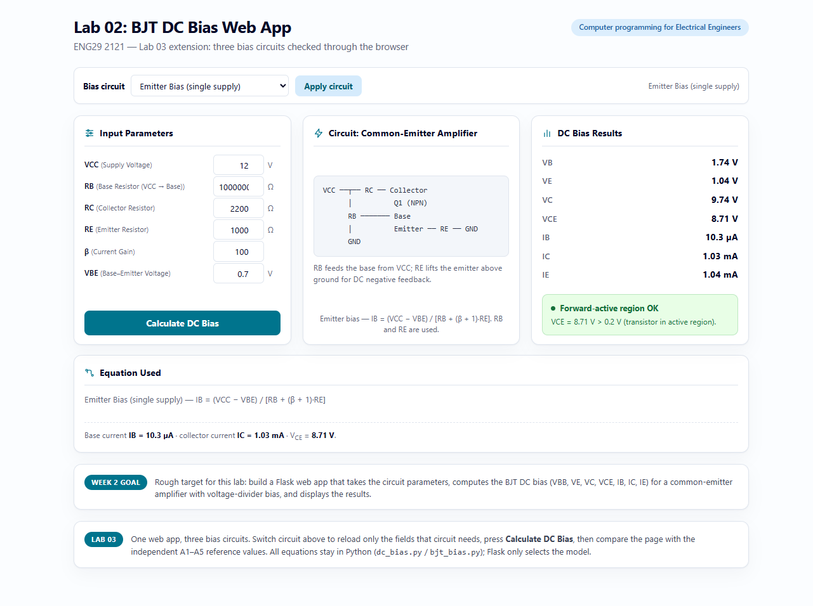
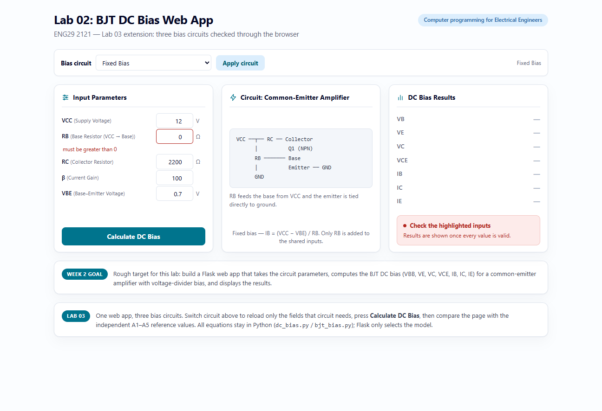

# BJT Common-Emitter DC Bias Calculator — Lab 03

Flask web app ที่คำนวณจุดทำงานกระแสตรง (Q-point) ของทรานซิสเตอร์ NPN แบบ
common-emitter ได้ **3 วงจรไบอัส** จากเว็บเดียว:

| โหมด | วงจร | สมการหา I<sub>B</sub> | อินพุตที่ใช้ |
|---|---|---|---|
| `divider` | Voltage Divider Bias (ของเดิมจาก Lab 02) | `(VTH − VBE) / [RTH + (β+1)·RE]` | VCC, R1, R2, RC, RE, β, VBE |
| `fixed` | Fixed Bias | `(VCC − VBE) / RB` | VCC, RB, RC, β, VBE |
| `emitter` | Emitter Bias (แหล่งจ่ายเดียว) | `(VCC − VBE) / [RB + (β+1)·RE]` | VCC, RB, RC, RE, β, VBE |

โดย `VTH = VCC·R2/(R1+R2)` และ `RTH = R1·R2/(R1+R2)`

ค่าที่ได้จากทุกโหมด: `VB, VE, VC, VCE` (V), `IB, IC, IE` (A)
และ `IC` แสดงเป็น mA ด้วย ผลที่ได้อยู่ในรูป `dict` ที่มีคีย์และหน่วยตรงกันทุกโหมด
(`vb_v`, `ve_v`, `vc_v`, `vce_v`, `ib_a`, `ic_a`, `ie_a`, `ib_ua`, `ic_ma`,
`ie_ma`, `region`, `warnings`, ...)

**ข้อจำกัดช่วงนี้:** DC operating point เท่านั้น — ไม่มี SPICE, DC load line,
AC/transient หรือ bypass capacitor ไม่มี unittest ใหม่ (ใช้ชุดทดสอบเดิม
71 tests และตาราง A1–A5 ผ่านเบราว์เซอร์)

---

## วิธีเลือกวงจร

1. เปิดเว็บ แล้วใช้ dropdown **Bias circuit** ด้านบน เลือกโหมดแล้วกด
   **Apply circuit** — หน้าเว็บจะโหลดใหม่และโชว์เฉพาะช่องที่โหมดนั้นใช้
   (เช่น Fixed ไม่มีช่อง R1/R2/RE, Emitter มี RB และ RE)
2. กรอกค่าตามหน่วยบนฟอร์ม ( Resistance เป็น **Ω**: `1 MΩ = 1000000 Ω`,
   `1 kΩ = 1000 Ω`) แล้วกด **Calculate DC Bias**
3. การ์ด **Circuit: Common-Emitter Amplifier** จะแสดงภาพวงจร SVG ของโหมดนั้น
   พร้อมค่าตัวต้านทานที่กรอก (Divider มี R1/R2/RE, Fixed มี RB และ emitter
   ต่อกราวด์ตรง ๆ, Emitter มี RB และ RE) — ใช้สไตล์การ์ดสีเดียวกันทั้ง 3 แบบ
4. ผลและข้อความเตือนจะระบุโหมดที่เลือกเสมอ และถ้าอินพุตผิด ช่องผลจะเป็น
   `—` ทั้งหมด ไม่โชว์ผลของรอบก่อน

ไม่มี JavaScript ในหน้าเว็บ — การเปลี่ยนโหมดเป็น GET ธรรมดา
(`/?mode=fixed`) และการคำนวณเป็น POST พร้อม hidden field `mode`

## Inputs

| Field | ความหมาย | หน่วย | กฎ |
|---|---|---|---|
| `VCC` | แหล่งจ่าย | V | > 0, ≤ 1000 |
| `RB` | ตัวต้านทานเบส (Fixed/Emitter) | Ω | > 0, 10⁻⁶ … 10⁹ |
| `R1`, `R2` | ตัวแบ่งแรงดัน (Divider) | Ω | > 0, 10⁻⁶ … 10⁹ |
| `RC` | ตัวต้านทานคอลเลกเตอร์ | Ω | > 0, 10⁻⁶ … 10⁹ |
| `RE` | ตัวต้านทานอีมิเตอร์ (Divider/Emitter) | Ω | 0 หรือ 10⁻⁶ … 10⁹ |
| `β` | current gain | — | 1 … 100000 |
| `VBE` | แรงดันเบส–อีมิเตอร์ | V | ≥ 0 และ < VCC |

อินพุตผิด → HTTP 400, แสดงข้อความข้างช่องนั้น และเก็บค่าที่กรอกไว้แก้ได้
โหมดที่ไม่รู้จักถูกปฏิเสธ (ไม่เดาว่าเป็น Divider)

## Region rules

| Region | เงื่อนไข | การแสดงผล |
|---|---|---|
| Active | VCE ≥ 1.0 V | แสดงผลปกติ |
| Near saturation | 0.2 V ≤ VCE < 1.0 V | เตือนว่า Q-point ไวต่อ β และ VBE |
| Saturation | VCE < 0.2 V | เตือนว่าแบบจำลอง forward active อาจใช้ไม่ได้ |
| Cut-off | IB ≤ 0 | เตือนว่าแบบจำลอง forward active อาจใช้ไม่ได้ |

Divider ยังคงมีตาราง **Exact vs Approximate** แบบ Lab 02 (เทียบ Thevenin
แบบ finite β กับวิธีประมาณ `IB ≈ 0`) และค่าอ้างอิง IC(sat)/forced β
เหมือนเดิมทุกประการ

## Run it (Windows)

```powershell
py -m venv .venv
.venv\Scripts\python.exe -m pip install -r requirements.txt
.venv\Scripts\python.exe -m flask --app app run
```

เปิด <http://127.0.0.1:5000>. ถ้าพอร์ต 5000 ถูกใช้ ให้เปลี่ยนพอร์ต:

```powershell
.venv\Scripts\python.exe -m flask --app app run --port 5001
```

## Run the tests

```powershell
.venv\Scripts\python.exe -m pytest -q
```

71 tests เดิมจาก Lab 02 ยังผ่านทั้งหมด (สูตร, region, validation, comparison,
SI formatting และ route-level) — เป็นหลักฐานว่าโหมด Divider ไม่เสียจากการเพิ่มวงจรใหม่

## Browser acceptance (A1–A5)

ค่าอ้างอิงอิสระคำนวณด้วย [`docs/reference_calculation.py`](docs/reference_calculation.py)
ซึ่ง **ไม่ import** `app.py`, `bjt_bias.py` หรือ `dc_bias.py` รายละเอียดและการทวนผล
อยู่ใน [`docs/validation.md`](docs/validation.md)

ใช้ร่วมกันทุกกรณี: `VCC = 12 V`, `RC = 2.2 kΩ`, `β = 100`, `VBE = 0.70 V`<br>
เกณฑ์ผ่าน: `|ΔIC| ≤ 0.01 mA` และ `|ΔVCE| ≤ 0.02 V` เมื่อเทียบค่าที่หน้าเว็บแสดง
(3 significant figures) กับค่าอ้างอิงที่ยังไม่ปัดเศษ

| กรณี | อินพุตที่กรอกจริง | ค่าคาดหมาย (มีหน่วย) | ผลจริงที่เห็นบนหน้าเว็บ (มีหน่วย) | วิธีตรวจ | สถานะ |
|---|---|---|---|---|---|
| **A1 · Divider (โหมดเดิม)** | `VCC=12, R1=100000, R2=22000, RC=2200, RE=1000, β=100, VBE=0.7` | `IC=1.229858 mA`, `VCE=8.052155 V` | `IC = 1.23 mA`, `VCE = 8.05 V`, `VBB = 2.16 V`, `IB = 12.3 µA`; `Active region approximation OK` | OpenCode Browser | **PASS** |
| **A2 · Fixed** | `VCC=12, RB=1000000, RC=2200, β=100, VBE=0.7` (**ไม่มีช่อง RE**) | `IC=1.130000 mA`, `VCE=9.514000 V` | `IC = 1.13 mA`, `VCE = 9.51 V`, `VE = 0 V`, `IB = 11.3 µA`; `Forward-active region OK` | OpenCode Browser | **PASS** |
| **A3 · Emitter** | `VCC=12, RB=1000000, RC=2200, RE=1000, β=100, VBE=0.7` | `IC=1.026340 mA`, `VCE=8.705450 V` | `IC = 1.03 mA`, `VCE = 8.71 V`, `VE = 1.04 V`, `IB = 10.3 µA`; `Forward-active region OK` | OpenCode Browser | **PASS** |
| **A4 · เปลี่ยนค่าเดียวจาก A3** | Emitter · เหมือน A3 ทุกประการ เปลี่ยนเฉพาะ `RE=2000` | ทำนายว่า **IC ลดลง** เพราะ `(β+1)·RE` ในตัวหารเพิ่มขึ้น; ค่าอ้างอิง `IC=0.940100 mA`, `VCE=8.032779 V` | `IC = 940 µA` (ลดจาก `1.03 mA`), `IB = 9.4 µA` (ลดจาก `10.3 µA`), `VCE = 8.03 V` → ทิศทางตรงตามทำนาย | OpenCode Browser | **PASS** |
| **A5 · อินพุตผิด** | Fixed · `RB=0` (ที่เหลือเหมือน A2) | มีข้อความให้แก้ RB, เว็บไม่ล่ม, ไม่โชว์ผลเดิมเป็นผลรอบนี้ | ข้อความถัดจากช่อง RB: `must be greater than 0`; status `Check the highlighted inputs`; ช่องผลทั้ง 7 ช่องเป็น `—` หมด | OpenCode Browser | **PASS** |

ตรวจเกณฑ์ตัวเลขเพิ่มได้:

| กรณี | \|ΔIC\| (mA) | \|ΔVCE\| (V) | ผล |
|---|---:|---:|---|
| A1 | 0.000142 | 0.002155 | ผ่าน |
| A2 | 0.000000 | 0.004000 | ผ่าน |
| A3 | 0.003660 | 0.004550 | ผ่าน |
| A4 | 0.000100 | 0.002779 | ผ่าน |

### หลักฐานจากหน้าเว็บ

ข้อความผลด้านบนคัดมาจาก accessibility snapshot ของหน้าเว็บหลังกรอกฟอร์มและกด
**Calculate DC Bias** จริง ไม่ได้อ่านจากโค้ด และมีภาพหน้าจอแนบอย่างน้อย 1 กรณี:

- **A3** — เห็น `IC = 1.03 mA`, `VCE = 8.71 V`:

  

- **A5** — เห็น `must be greater than 0` และผล `—` ทุกช่อง:

  

- ภาพวงจรที่ใช้ตรวจทุกโหมด:
  [Divider](docs/evidence/schematic-divider-bias.png) ·
  [Fixed](docs/evidence/schematic-fixed-bias.png) ·
  [Emitter](docs/evidence/schematic-emitter-bias.png)

### เครื่องมือที่ใช้ / เหตุผลที่เปลี่ยน

- ตรวจจริงด้วย **OpenCode Browser**: เปิด URL จริง ใช้ dropdown **Bias circuit →
  Apply circuit** กรอกช่องในฟอร์มด้วยเครื่องมือ fill แล้วกด **Calculate DC Bias**
- **Playwright MCP: NOT RUN** — ไม่ได้ตั้งค่า MCP server ในเครื่องนี้ จึงใช้
  **OpenCode Browser** แทนตามเงื่อนไขในใบงาน (ให้คะแนนการตรวจผลเท่ากันทุกวิธี)
- ไม่ได้ใช้ `curl` หรืออ่านโค้ดแทนการรันเบราว์เซอร์ และไม่พบ error/warning
  ใน browser console ระหว่างรอบตรวจ

## Files

```
app.py                      Flask routes: เลือกโหมดด้วย if/elif, ตรวจอินพุตตามโหมด
bjt_bias.py                 วิศวกรรมเดิมของ Lab 02 (Divider, exact/approx, region)
dc_bias.py                  ฟังก์ชันใหม่ solve_fixed/solve_emitter/solve_divider + validator
formatting.py               SI-prefix number formatting
templates/index.html        mode selector, ฟอร์มตามโหมด, ผลลัพธ์, การตรวจสอบ
static/style.css            stylesheet
tests/                      ชุดทดสอบเดิม 71 tests (ไม่เปลี่ยน)
docs/validation.md          A1–A5, ค่าอ้างอิง, หลักฐาน, บทบาท MCP
docs/reference_calculation.py   สคริปต์คำนวณค่าอ้างอิงอิสระ
docs/evidence/              ภาพหน้าจอจากเบราว์เซอร์
docs/superpowers/           spec/plan เดิมของ Lab 02
requirements.txt            Flask, pytest
```

## สิ่งที่ AI เขียน vs สิ่งที่ตรวจ

- **AI เขียน:** `dc_bias.py` (ฟังก์ชัน Fixed/Emitter, validator ตามโหมด, รูป dict ร่วม),
  ส่วนที่เลือกโหมดใน `app.py`, โครงฟอร์ม/ผลใน `index.html`, CSS ของ mode bar
- **ผู้สอน/นักศึกษาตรวจ:** สมการเทียบใบงาน (IB ของทั้ง 3 วงจร และ VE ของ Fixed ที่เป็น 0),
  หน่วย Ω/A → V/mA, ค่าอ้างอิงอิสระ A1–A4, ว่า Divider ให้ผลเดิม (ชุดทดสอบ 71 tests),
  และผลจริงจากเบราว์เซอร์ A1–A5

## Submission

- GitHub: <https://github.com/JirapatMax/Gitlab>
- งาน Lab 3 อยู่บน branch `main`
- Commit SHA ของงานนี้ดูได้จาก `git log -1 --format=%H` หรือจากคำตอบที่ส่งพร้อมตาราง A1–A5

## Limitations

- DC only: ไม่มี AC gain, frequency response หรือ transient
- β และ VBE เป็นค่าคงที่ที่ผู้ใช้ป้อน ไม่มี temperature sweep หรือ self-heating
- เฉพาะ NPN common-emitter 3 วงจรนี้ ไม่มี PNP/FET หรือ circuit editor
- โมเดลเป็นแบบตำรา ไม่มี Early effect, recombination หรือ parasitic resistance
- ในย่าน cutoff/saturation แสดงผลของแบบจำลอง *forward active* ไว้ให้ดู
  พร้อมข้อความเตือน แต่ไม่ได้คำนวณค่าจริงของ cutoff/saturation ให้
